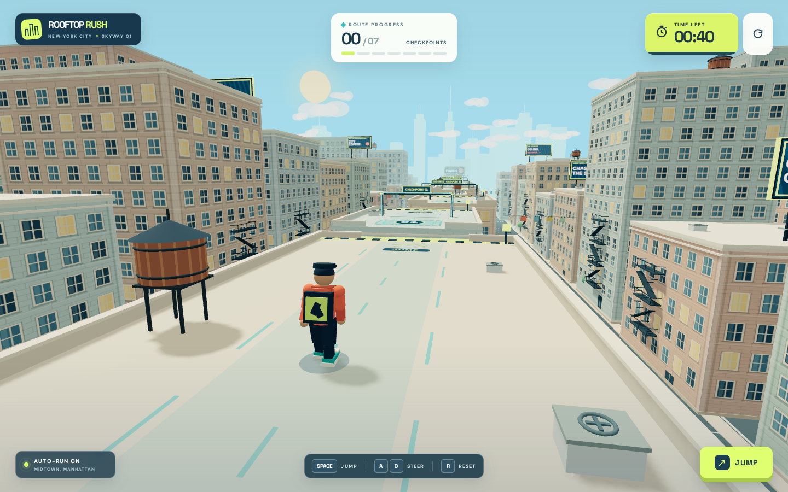
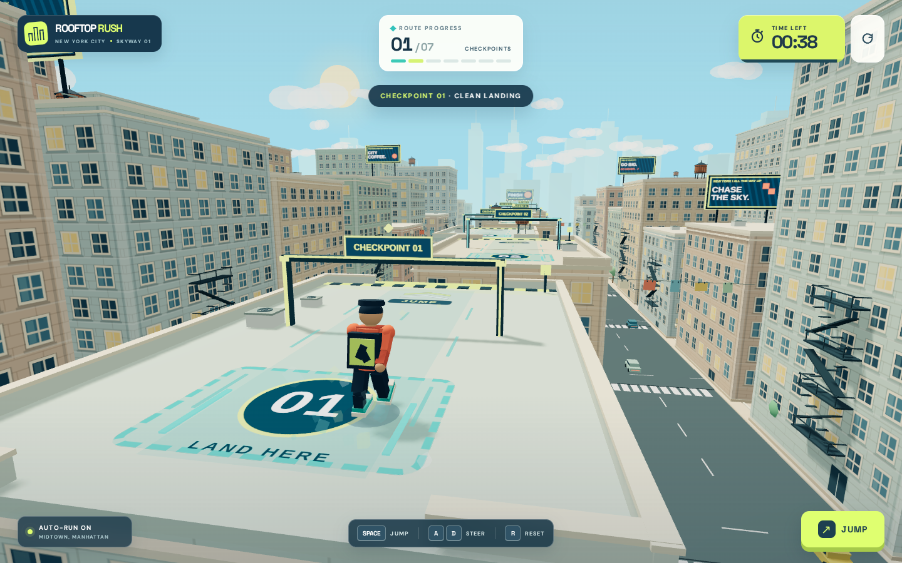
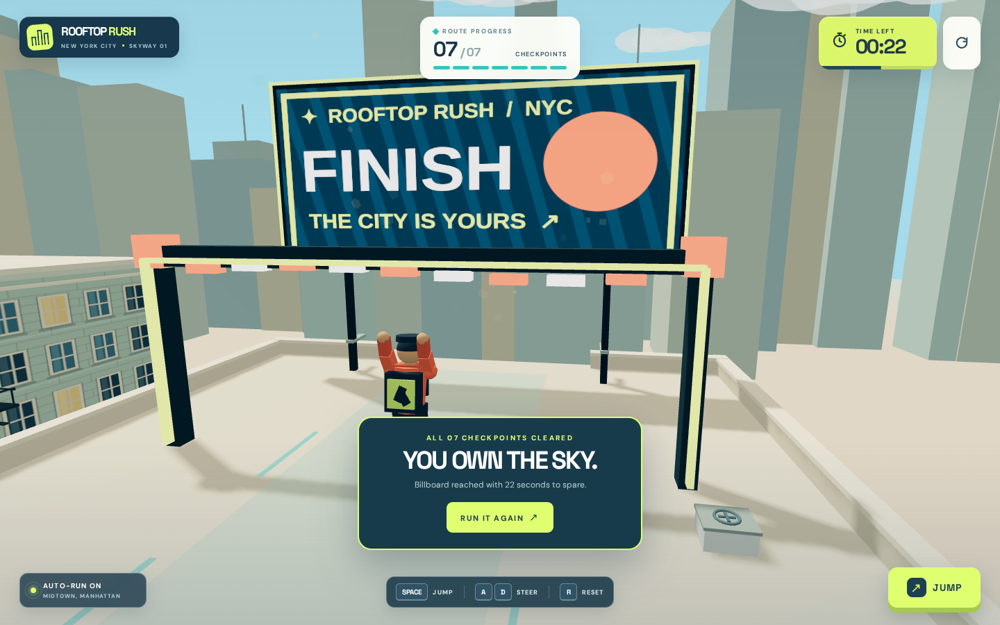
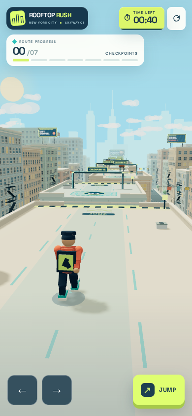

# Rooftop Rush

**A bright, immediately playable Three.js parkour run above a stylized New York street canyon.** The runner is already moving when the page loads—no menu or press-start screen.

**[Play the game →](https://rooftop-rush-one.vercel.app/)**



## Real gameplay screenshots

These images were captured from the running game in Chromium with Playwright, not generated mockups.

<p align="center">
  
  
</p>
<p align="center">
  
</p>

## The run

Jump across eight rooftop gaps, land on seven glowing checkpoints, then reach the final billboard before the 40-second timer expires. Falling returns you to the latest checkpoint and costs 2.5 seconds. The route winds past water towers, fire escapes, vents, clotheslines, billboards, window grids, and traffic far below.

| Action | Desktop | Touch |
| --- | --- | --- |
| Jump | Space, ↑, W, or click | Tap the scene or **JUMP** |
| Steer | A / D or ← / → | On-screen arrows |
| Reset | R or the reset button | Reset button |

The runner moves forward automatically. The camera follows close behind.

## Run locally

```sh
npm install
npm run dev
```

## Test and capture

```sh
npx playwright install chromium
npm run test:e2e
npm run screenshots
npm run build
```

The browser test covers every jump, checkpoint recovery, the timer, reset, keyboard input, and touch input. `npm run screenshots` recaptures the images above from the actual game.

The Vercel production deployment is currently a manual upload, not a Git-connected deployment; pushing to a repository alone will not update the live game.
